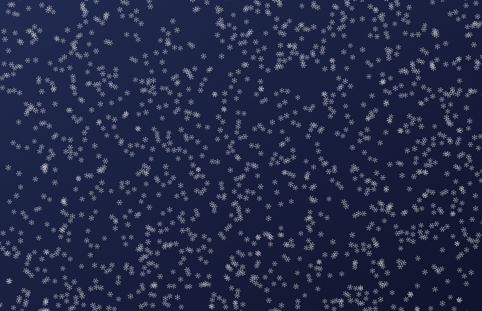
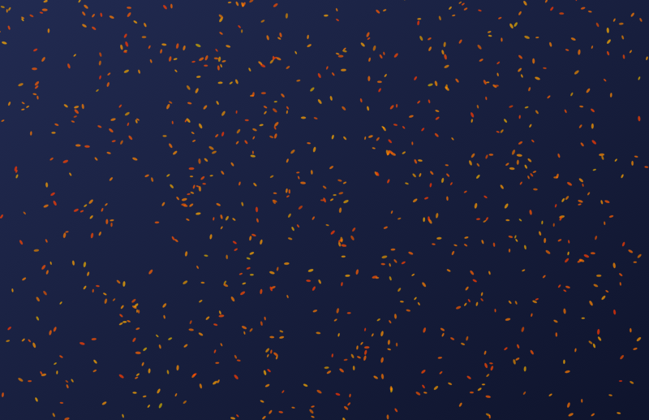
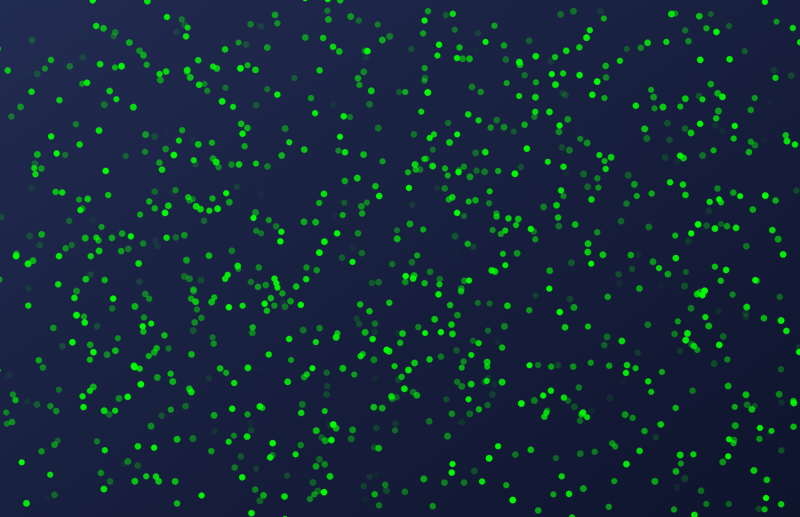

# ParticleFX

macOS 菜单栏粒子特效应用：让雪花、樱花、落叶、萤火虫飘满你的桌面。

| ❄️ 雪花 | 🌸 樱花 |
| :---: | :---: |
|  |  |
| **🍂 落叶** | **✨ 萤火虫** |
|  |  |

## 功能

- **4 种粒子**：❄️ 雪花 / 🌸 樱花 / 🍂 落叶 / ✨ 萤火虫
- **菜单栏实时调节**：密度、速度、大小、大小范围、透明度、风力
- **多显示器支持**：每块屏幕独立渲染
- **层级切换**：置顶显示，或置于窗口之下（纯桌面氛围）
- **低功耗**：30fps 渲染，隐藏时自动暂停渲染循环
- **多语言**：中文 / English / 日本語 / Français / Deutsch

## 安装

1. 从 [Releases](https://github.com/Boxer-egg/FX/releases/latest) 下载 `ParticleFX.dmg`
2. 打开 DMG，将 **ParticleFX.app** 拖入 **Applications**
3. 首次启动如提示"无法验证开发者"：右键点按 App → **打开**；或执行：
   ```bash
   xattr -dr com.apple.quarantine /Applications/ParticleFX.app
   ```

## 使用

点击菜单栏的 ✨ 图标打开控制菜单。

| 快捷键 | 作用 |
| --- | --- |
| `⌘ 1` ~ `⌘ 4` | 切换粒子类型 |
| `⌘ ⇧ T` | 显示 / 隐藏粒子 |
| `⌘ Q` | 退出 |

## 从源码构建

要求：macOS 13+，Swift 5.9+（Xcode 或 Command Line Tools）。

```bash
make            # 构建并打包 ParticleFX.app
make run        # 构建并运行
./release.sh 0.2   # 发布新版本：构建 → DMG → GitHub Release（需 gh 已登录）
```

## 技术栈

SwiftUI + SpriteKit + AppKit，纯系统框架，无第三方依赖。

## 官网

https://boxer-egg.github.io/FX-web/
